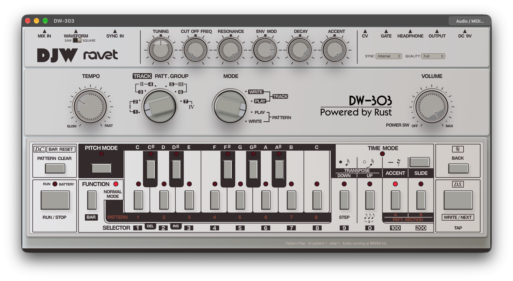

# DW-303

A circuit-modelled bass line synthesizer and step sequencer, built on RAVET.
Formats: CLAP, AU, VST3, LV2, AAX and standalone.



Signed, ready-to-install builds are available from [djwaudio.co](https://djwaudio.co).

## Building from source

DW-303 is built on [RAVET](https://github.com/mo0kid/ravet), which must be
checked out next to this repository:

```sh
git clone https://github.com/mo0kid/ravet.git
git clone https://github.com/mo0kid/DW-303.git
cd DW-303
cargo test --workspace
```

Requires Rust 1.88 or later. The plug-in bundle and standalone app scripts need
Python 3.11+ and are currently macOS only:

```sh
python3 scripts/bundle-clap.py       # CLAP bundle (ad hoc signed)
python3 scripts/bundle-app.py        # standalone DW-303.app
```

See [docs/standalone.md](docs/standalone.md), [docs/editor.md](docs/editor.md)
and [docs/sequencer.md](docs/sequencer.md) for details, and
[docs/circuit](docs/circuit) for the circuit models and how they were fitted.

## License

The source code is licensed under the GNU General Public License v3.0 or later.
See [LICENSE](LICENSE).

The DW-303 name, DJW Audio name and logo, and the panel artwork are not covered
by the code license. Forks and redistributed builds must use a different name
and artwork.

TB-303 and Roland are trademarks of Roland Corporation. DW-303 is an independent
project and is not affiliated with or endorsed by Roland.
